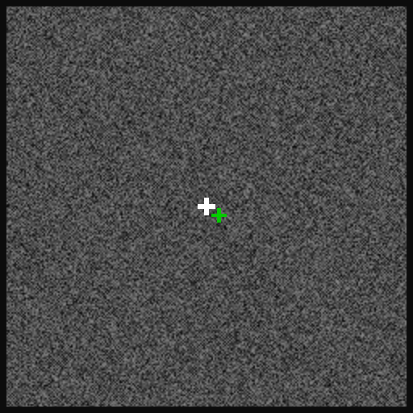

# PAPER TITLE

<!-- TODO: fill in the paper title, the GitHub URL, the OSF URL and the citation below. -->

This repository contains the code and points to the data behind the paper
"PAPER TITLE" (Watters et al., 2026). The paper uses neurophysiology data
recorded in the frontal cortex (DMFC and FEF) of two monkeys, Monkey P (`Perle`)
and Monkey E (`Elgar`), while they performed a multi-object working memory task.
It also tests computational models against that data.

Use this repository to reproduce the paper's figures, or as a starting point for
working with the data yourself.



*One trial, replayed from the recorded data (Monkey P, 2022-06-11, trial 200):
fixation, two objects shown, a delay with the objects hidden, a cue identifying
one object, then the monkey's saccade to where it remembers that object. The
green cross is the monkey's gaze.*

## Repository layout

| Directory | Contents |
|---|---|
| `figures/` | One directory per figure, with Jupyter notebooks that make each panel |
| `behavior_processing/` | Builds the trial table `ring.csv` from the DANDI behavior files |
| `phys_processing/` | Bins spikes per trial from the DANDI spike-sorting files |
| `data_exploration/` | Trial replays, PSTHs and unit summary plots for exploring the data |
| `cache/` | Data and intermediate results. Not in git; see below |
| `download_dandi_data.py` | Downloads the data from DANDI |

## Setup

1. Clone the repository:
   ```
   git clone GITHUB_URL
   cd REPO_NAME
   ```
2. Create an environment with Python 3.10 or newer (the code was developed with
   Python 3.12), for example with conda:
   ```
   conda create -n relational_neurons python=3.12
   conda activate relational_neurons
   ```
3. Install the dependencies:
   ```
   pip install -r requirements.txt
   ```
   `requirements.txt` groups the packages by what needs them. `moog-games` is
   needed only to render task frames, and the last group only for the MRI figure
   (`supp_figure_8`).

Run every script and notebook from its own directory. Paths in the notebooks are
relative to the notebook's location.

## Downloading the data

All of the data are on DANDI as
[dandiset 000620](https://dandiarchive.org/dandiset/000620). The scripts expect
the files under `cache/dandi_data/`, and `download_dandi_data.py` puts them
there. It downloads only the 23 ring-task sessions this paper uses (the
dandiset also holds sessions of another task).

1. The dandiset is public, so no DANDI account or API key is needed. If you
   want to use one anyway, set the `DANDI_API_KEY` environment variable or save
   the key in `DANDI_API_KEY.txt` in the repository root (`.gitignore` excludes
   it).
2. From the repository root, run:
   ```
   python download_dandi_data.py --modality=spikesorting   # ~1.8 GB
   python download_dandi_data.py --modality=behavior       # ~5.8 GB
   ```
   To get a single session, add `--subject` and `--session`, e.g.
   `--subject=Perle --session=2022-06-11`.

Which files you need:
- **Spike-sorting files** are needed for every figure with neural data.
- **Behavior/task files** are needed to rebuild `ring.csv` and to render task
  frames (`figure_1/trial_structure`, `supp_figure_7/binding_capacity/stimulus_frame`,
  and `data_exploration/`).

The raw electrophysiology files are also on DANDI but are several terabytes. You
need them only to redo the spike sorting, which this repository does not cover.

## Exploring the data

Each of the following needs only one session. Download it with
`python download_dandi_data.py --subject=Perle --session=2022-06-11`, and build
`ring.csv` (step 1 under "Generating the caches") for the PSTHs.

- **Replay a trial**: `data_exploration/task_visualization/demo_replay_trial.ipynb`
  writes the gif above to `data_exploration/task_visualization/gifs/`.
  `demo_replay_trials_with_neurons.ipynb` makes a video of several trials with
  spikes from a few neurons played as clicks.
- **Plot a neuron's PSTH**: `data_exploration/psths/demo.ipynb`. To plot every
  single unit, run `python run_ring.py` in that directory; the PDFs go to
  `cache/data_exploration/psths/`.
- **Plot a unit summary** (waveform, ISI distribution, raster, PSTH):
  `data_exploration/unit_summary_plots/demo.ipynb`. To plot every unit, run
  `python run.py` in that directory; the plots go to
  `cache/data_exploration/unit_summary_plots/`.

To work with spike counts directly, use `phys_processing/spike_counts.py` (see
`phys_processing/README.md`).

## Generating the caches

The figures read intermediate results from `cache/`. There are two ways to fill it.

### Option A: download the precomputed caches

Download `CACHE_ARCHIVE_NAME` from OSF at OSF_URL, unzip it, and move its
contents into `cache/`. It contains `behavior_processing/`, `figures/` and
`mris/`. After this you can skip straight to "Reproducing the figures". The
figures that use neural data still need the DANDI spike-sorting files.

### Option B: rebuild from the DANDI data

With the DANDI behavior and spike-sorting files downloaded, one command builds
every cache the figures need (all except the MRI figure's MRI scans):
```
cd figures
python build_caches.py --n-jobs 6
```
This takes several hours. Every step checkpoints its work, so if it is
interrupted, run it again (or resume from a step with `--from <step>`).
`python build_caches.py --dry-run` prints the individual commands, which you can
also run yourself, in this order:

1. **Trial table** (seconds): `behavior_processing/run_cache_data.py` writes
   `cache/behavior_processing/ring.csv`, with one row per trial.
2. **Per-trial firing rates** (~2 min): `figures/firing_rates.py` writes
   `cache/figures/shared_inputs/firing_rates/`, the per-trial rates that
   figures 3 and 4 both start from.
3. **Neuron selection** (~10 min): `figures/figure_3/model_comparison/run_modulation_cache.py`
   writes `cache/figures/shared_inputs/modulation.csv`, the statistic that
   decides which neurons enter every population figure.
4. **Figure 3 model comparison** (~15 min each): `run_comparison_cache.py`
   and `run_phase_cache.py`, in
   `figures/figure_3/model_comparison/`.
5. **Figure 4 model fits** (several hours): `figures/figure_4/run_cache.py`.
6. **Supplementary figure 2** (task-phase split, about 4 hours):
   `figures/supp_figure_2/build_cache.py`.

Run each script from its own directory. They all take `--n-jobs`, and `--help`
lists their other options. Every other cache (decoders, response profiles, the
single-unit table, ...) is built automatically the first time a notebook needs
it, and reused after that.

## Reproducing the figures

Open the notebooks in Jupyter (`jupyter lab` from the repository root) and run
them top to bottom. Most save their panels as PDFs in their own directory.

| Figure | Notebooks (in `figures/`) | Needs |
|---|---|---|
| 1 | `figure_1/`: `trial_structure`, `stimulus_sampling`, `responses_aligned`, `swap_errors`, `repulsion_bias` | `ring.csv`; `trial_structure` also needs a behavior file and `moog-games` |
| 2 | `figure_2/`: `psth`, `rf_per_anchor` | `ring.csv`, spike-sorting files |
| 3 | `figure_3/model_comparison/`: `model_comparison`, `rf_orientation`, `ideal_neurons`<br>`figure_3/efficient_coding/`: `titration`<br>`figure_3/efficient_coding_schematic/`: `decoding`<br>`figure_3/motor_decoding/`: `decoder_v2`<br>`figure_3/motor_decoding_schematic/`: `rf_response_map` | Steps 2–4 |
| 4 | `figure_4/`: `computational_model`, `future_field_proof`, `figure_example_neurons`, `figure_example_model_neurons`, `tuning_plots`, `figure_tuning`, `figure_model_comparison`, `figure_relationality`, `figure_ks_stats` | Steps 2, 3 and 5, spike-sorting files |
| S1 | `supp_figure_1/`: `model_wins_and_probability`, `rf_orientation`, `figure_model_comparison`, `figure_relationality`, `figure_ks_stats` | Steps 2–5 |
| S2 | `supp_figure_2/`: the same five notebooks | Steps 2, 3 and 6 |
| S3 | `supp_figure_3/`: `gradients`, `gradients_ideal` | Steps 2–4 |
| S4 | `supp_figure_4/`: `decoder_1obj_error` | Steps 2–4 |
| S5 | `supp_figure_5/`: `relationality_examples` | Steps 2 and 5 |
| S6 | `supp_figure_6/`: `distance_future_field` | Steps 2 and 5 |
| S7 | `supp_figure_7/binding_capacity/`: `synthetic`, `stimulus_frame` | `synthetic` needs nothing; `stimulus_frame` needs a behavior file and `moog-games` |
| S8 | `supp_figure_8/`: `probes_on_mri`, `probes_3d` | `cache/mris/` (from Option A), spike-sorting files; see `supp_figure_8/README.md` |
| S9 | `supp_figure_9/`: the same five notebooks as S1, single units only | Steps 2–5 |
| S10 | `supp_figure_10/`: `prototype_means` | `ring.csv`, spike-sorting files |

Every threshold that decides which neurons and trials enter an analysis is set
in `figures/config.py`. Changing a value there changes every figure that uses
it; the comments in that file say which changes need a cache rebuilt.

## Spike sorting

We spike-sorted the raw data by correcting for drift, running Kilosort 2.5,
applying a custom automated quality-labeling pipeline, and curating the results
by hand. That pipeline is not part of this repository. To spike-sort the raw
data yourself, we recommend the
[SpikeInterface](https://spikeinterface.readthedocs.io/en/stable/) toolkit.

## Contact and Support

Please email Nick Watters at [nwatters@mit.edu](mailto:nwatters@mit.edu) with
questions and feedback. If you plan to use our data for your own research, we
encourage you to email Nick Watters ([nwatters@mit.edu](mailto:nwatters@mit.edu))
or Mehrdad Jazayeri ([mjaz@mit.edu](mailto:mjaz@mit.edu)), so we can help you
determine whether our data is useful for your scientific goals and discuss any
limitations or challenges that might arise.

## Reference

If you use our data or code (or a derivative of our data or code) in your work,
please cite it as follows:

```
CITATION (BibTeX)
```
