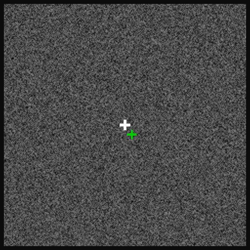

# Task Visualization

This directory contains tools to visualize the task and behavior of the monkeys.
There are two entrypoints:

- `demo_replay_trial.ipynb`. Run this notebook to generate a gif file replaying
  a list of trials of task and behavior, one after another.
- `demo_replay_trials_with_neurons.ipynb`. Run this notebook to generate a video
  of trials of task and behavior with audio showing spike times from some
  neurons.

Here is the gif `demo_replay_trial.ipynb` makes by default (Monkey P,
2022-06-11, trials 251, 401, 349, 1156, 402 and 465). The green cross is the
monkey's gaze:

